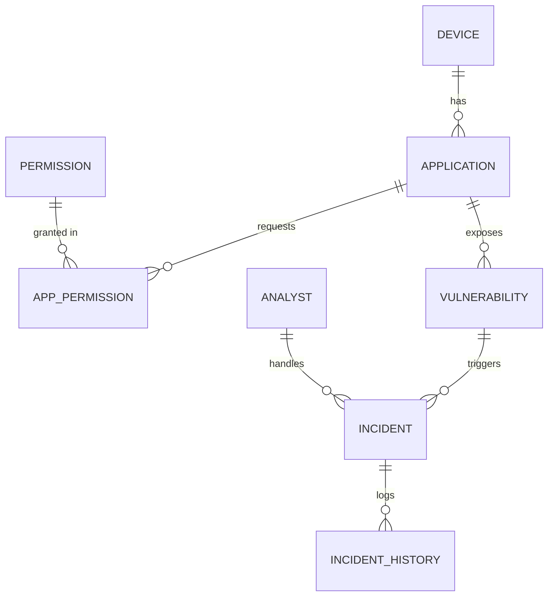

# M-SHIELD — Mobile Security Incident & Vulnerability Management System

A centralized relational database for recording and tracking mobile security
issues: devices, installed apps, requested permissions, vulnerabilities,
incidents, and a full audit history. Built as an **academic DBMS project** —
the emphasis is on database design (schema, normalization, keys, constraints,
joins, views, triggers), **not** real security scanning. All security data is
sample/simulated.

- **Database:** MySQL 8.x (InnoDB, utf8mb4; `CHECK` constraints need 8.0.16+)
- **Format:** plain `.sql` files — run in MySQL Workbench or the `mysql` CLI
- **Backend:** none required

---

## Project Overview

M-SHIELD models how a security team manages a fleet of mobile devices:

1. **Devices** run **applications**.
2. Applications request **permissions** (many-to-many); each permission carries
   a risk weighting.
3. Applications are found to have **vulnerabilities**.
4. A vulnerability can raise one or more **incidents**, assigned to **analysts**.
5. Every incident status change is written to an **incident history** audit log
   — automatically, by a trigger.

See [`docs/ER-diagram.md`](docs/ER-diagram.md) for the full entity–relationship
model, cardinalities, and relational schema.

## ER Diagram



## Repository Layout

```
dbms_project/
├── README.md                 # this file
├── docs/
│   └── ER-diagram.md         # entities, relationships, cardinality, schema
└── sql/
    ├── 01_schema.sql         # CREATE TABLEs: keys, constraints, FK actions
    ├── 02_sample_data.sql    # simulated INSERT data
    ├── 03_views.sql          # reporting views
    ├── 04_triggers.sql       # incident-history audit triggers
    ├── 05_queries.sql        # 12 demonstrative queries + trigger demo
    └── 06_teardown.sql       # DROP everything for a clean reset
```

## Setup & Run

### Option A — MySQL CLI

Run the files **in order**. Each file selects the `mshield` schema itself
(`01_schema.sql` creates it).

```bash
mysql -u root -p < sql/01_schema.sql
mysql -u root -p < sql/02_sample_data.sql
mysql -u root -p < sql/03_views.sql
mysql -u root -p < sql/04_triggers.sql
mysql -u root -p < sql/05_queries.sql
```

Or in a single session:

```bash
mysql -u root -p
```
```sql
SOURCE sql/01_schema.sql;
SOURCE sql/02_sample_data.sql;
SOURCE sql/03_views.sql;
SOURCE sql/04_triggers.sql;
SOURCE sql/05_queries.sql;
```

### Option B — MySQL Workbench

Open each `.sql` file (01 → 05) and click the lightning-bolt **Execute** button
in sequence. The schema, data, views, triggers, and demo queries will build up
step by step.

### Reset

```bash
mysql -u root -p < sql/06_teardown.sql
```

> **Run order matters.** Triggers (04) must be created *after* sample data (02)
> is loaded, because the seed history rows in 02 are inserted manually and the
> trigger demo lives in 05. Files 01 → 05 execute cleanly end to end.

## Web Console (optional live dashboard)

A self-contained web interface lives in `web/`. It is a **zero-dependency Node
server** (no npm packages) that runs live queries against the `mshield`
database through the installed `mysql` client and serves a dark-theme dashboard.

```bash
cd web
DB_USER=mshield_demo DB_PASS=<password> ./start.sh   # then open http://localhost:3000
```

Tabs: **Overview** (KPI tiles + severity/status charts + analyst workload),
**Devices**, **Applications**, **Permissions**, **Vulnerabilities**,
**Incidents**, and **Analysts**.

It supports full **CRUD** — all writes go through the real schema, so every
constraint and trigger fires live:

| Operation | Demonstrates |
|---|---|
| Add / edit / delete a **device** | `INSERT`/`UPDATE`/`DELETE`; delete shows **`ON DELETE CASCADE`** (apps, vulns, incidents go too) |
| Add / edit / delete an **analyst** | **`UNIQUE`** email rejected if duplicated; delete shows **`ON DELETE SET NULL`** on incidents |
| Add / delete an **application** | FK to device; cascade on delete |
| Manage an app's **permissions** | writes the **`app_permission`** bridge (the M:N relationship) |
| Add / delete a **permission** | master list + **`CHECK`** on risk level |
| Add / delete a **vulnerability** | FK to app + **`CHECK`** on severity |
| Add an **incident** | fires the **AFTER INSERT trigger** → a `CREATED` row appears in the audit trail |
| Change an incident's **status** | fires the **AFTER/BEFORE UPDATE triggers** → `incident_history` row + `resolved_at` auto-stamped, shown live |

Invalid input (bad enum, duplicate unique value, missing required field) is
rejected by the database and surfaced as a friendly error — a live
demonstration that integrity is enforced at the data layer, not the UI.

> The web console is a presentation layer; the database (`sql/*.sql`) is the
> actual project. The dashboard reads and writes through the same schema,
> constraints, and triggers.

## Normalization (to 3NF) — brief explanation

The schema is normalized to **Third Normal Form**:

- **1NF** — every column holds a single atomic value; there are no repeating
  groups. An app's many permissions are *not* stored as a comma-list on
  `application`; they live as individual rows in `app_permission`.
- **2NF** — every non-key attribute depends on the *whole* primary key. The
  only composite key is `app_permission(app_id, permission_id)`, and that table
  holds no attributes beyond the key, so there are no partial dependencies.
- **3NF** — no transitive dependencies. A permission's `risk_level` depends on
  the permission, so it lives in `permission`, not duplicated on every app that
  requests it. Likewise an analyst's details sit in `analyst`, referenced from
  `incident` by key only. Volatile audit data is split into
  `incident_history` so updating an incident never causes update anomalies.

## DBMS Concepts Covered — checklist

- [x] **Normalization to 3NF** (explained above; master-list + bridge tables)
- [x] **PRIMARY KEY** — surrogate (`AUTO_INCREMENT`) and composite (`app_permission`)
- [x] **FOREIGN KEY** with referential actions — `ON DELETE CASCADE` down the
      ownership chain, `ON DELETE SET NULL` for `incident.assigned_analyst_id`,
      `ON UPDATE CASCADE` throughout
- [x] **CHECK constraints** for enum domains — severity (`Low/Medium/High/Critical`),
      status (`Open/Investigating/Resolved/Closed`), priority (`Low/Medium/High`),
      risk level, OS type, device status; plus a cross-column check
      (`resolved_at >= created_at`)
- [x] **NOT NULL, UNIQUE, DEFAULT** — e.g. unique `permission.name` and
      `analyst.email`; default `status='Open'`, `created_at=CURRENT_TIMESTAMP`
- [x] **Indexes** on all foreign keys for join performance
- [x] **VIEWS (4)** — high-severity open incidents; apps with risky permissions;
      full incident detail; analyst workload
- [x] **JOIN-heavy query** across 5 tables (device → app → vuln → incident → analyst)
- [x] **AFTER UPDATE TRIGGER** on `incident` auto-logging status changes to
      `incident_history` (plus AFTER INSERT and a BEFORE UPDATE that maintains
      `resolved_at`)
- [x] **Aggregation** — vulns per severity, incidents per analyst, avg resolution
      time, `GROUP BY ... HAVING`
- [x] **Subqueries** — correlated (`EXISTS`), scalar-in-SELECT, and anti-join (`NOT IN`)

## Sample Data at a Glance

| Entity | Rows | Highlights |
|---|---|---|
| Devices | 5 | Android + iOS; Active / Quarantined / Retired |
| Applications | 10 | incl. the shady `QuickCleaner` and `FreeFlashlight` |
| Permissions | 12 | risk-weighted master list |
| Vulnerabilities | 8 | Low → Critical, some with CVE refs |
| Analysts | 4 | Lead / Analyst / Junior / Incident Manager |
| Incidents | 8 | one deliberately **unassigned** (NULL analyst) |
| Incident history | 9 seeded | grows automatically via triggers |

`QuickCleaner` is the textbook red flag: a "cleaner" app requesting `READ_SMS`,
`SEND_SMS`, `READ_CONTACTS`, `READ_CALL_LOG`, and fine location — surfaced by
the `v_apps_with_risky_permissions` view and query Q5.

---

*M-SHIELD is a teaching project. Vulnerabilities, CVE references, and incidents
are fictional and exist solely to demonstrate relational database design.*
