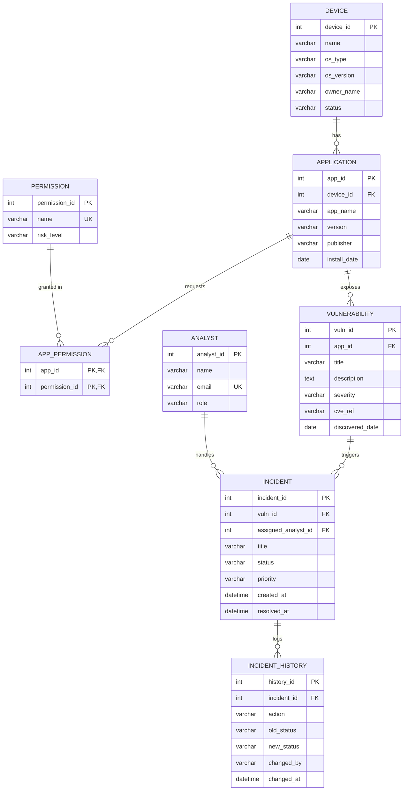

# M-SHIELD — Entity–Relationship Model

This document describes the conceptual data model for the Mobile Security
Incident & Vulnerability Management System (M-SHIELD). All data is simulated
for academic purposes.

## Entities

| Entity | Description | Primary Key |
|---|---|---|
| **DEVICE** | A managed mobile endpoint (phone/tablet). | `device_id` |
| **APPLICATION** | An app installed on a device. | `app_id` |
| **PERMISSION** | Master list of OS permissions and their risk weighting. | `permission_id` |
| **APP_PERMISSION** | Associative entity linking apps to the permissions they request. | (`app_id`, `permission_id`) |
| **VULNERABILITY** | A security flaw discovered in an application. | `vuln_id` |
| **ANALYST** | A security team member who owns incidents. | `analyst_id` |
| **INCIDENT** | A tracked case raised from a vulnerability. | `incident_id` |
| **INCIDENT_HISTORY** | Append-only audit log of incident lifecycle events. | `history_id` |

## Relationships & Cardinality

| Relationship | Cardinality | Participation | Notes |
|---|---|---|---|
| DEVICE → APPLICATION | 1 : N | app total (every app belongs to a device) | `ON DELETE CASCADE` |
| APPLICATION ↔ PERMISSION | M : N | via APP_PERMISSION | bridge table, composite PK |
| APPLICATION → VULNERABILITY | 1 : N | vuln total | `ON DELETE CASCADE` |
| VULNERABILITY → INCIDENT | 1 : N | incident total | `ON DELETE CASCADE` |
| ANALYST → INCIDENT | 1 : N | incident **optional** (may be unassigned) | `ON DELETE SET NULL` |
| INCIDENT → INCIDENT_HISTORY | 1 : N | history total | `ON DELETE CASCADE` |

**Reading the cardinality:** one device has many applications; an application
may request many permissions and a permission may be requested by many
applications; one application exposes many vulnerabilities; one vulnerability
can spawn many incidents; one analyst handles many incidents (an incident need
not have an analyst); every incident accumulates many history entries.

## ER Diagram (Mermaid)



> Crow's-foot notation: `||` = exactly one, `o{` = zero-or-many. So
> `DEVICE ||--o{ APPLICATION` reads "one device relates to zero or more
> applications; each application relates to exactly one device."

## Relational Schema (text form)

```
device(device_id PK, name, os_type, os_version, owner_name, status)

application(app_id PK, device_id FK→device, app_name, version,
            publisher, install_date)

permission(permission_id PK, name UNIQUE, risk_level)

app_permission(app_id FK→application, permission_id FK→permission,
               PK(app_id, permission_id))

vulnerability(vuln_id PK, app_id FK→application, title, description,
              severity, cve_ref, discovered_date)

analyst(analyst_id PK, name, email UNIQUE, role)

incident(incident_id PK, vuln_id FK→vulnerability,
         assigned_analyst_id FK→analyst NULL, title, status, priority,
         created_at, resolved_at)

incident_history(history_id PK, incident_id FK→incident, action,
                 old_status, new_status, changed_by, changed_at)
```
